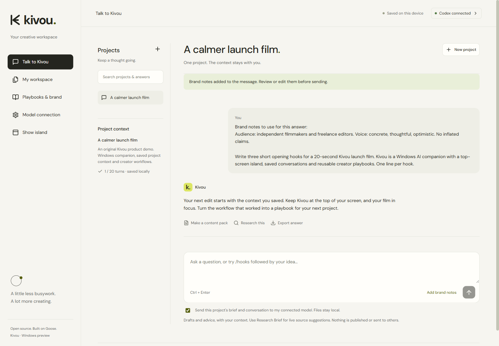
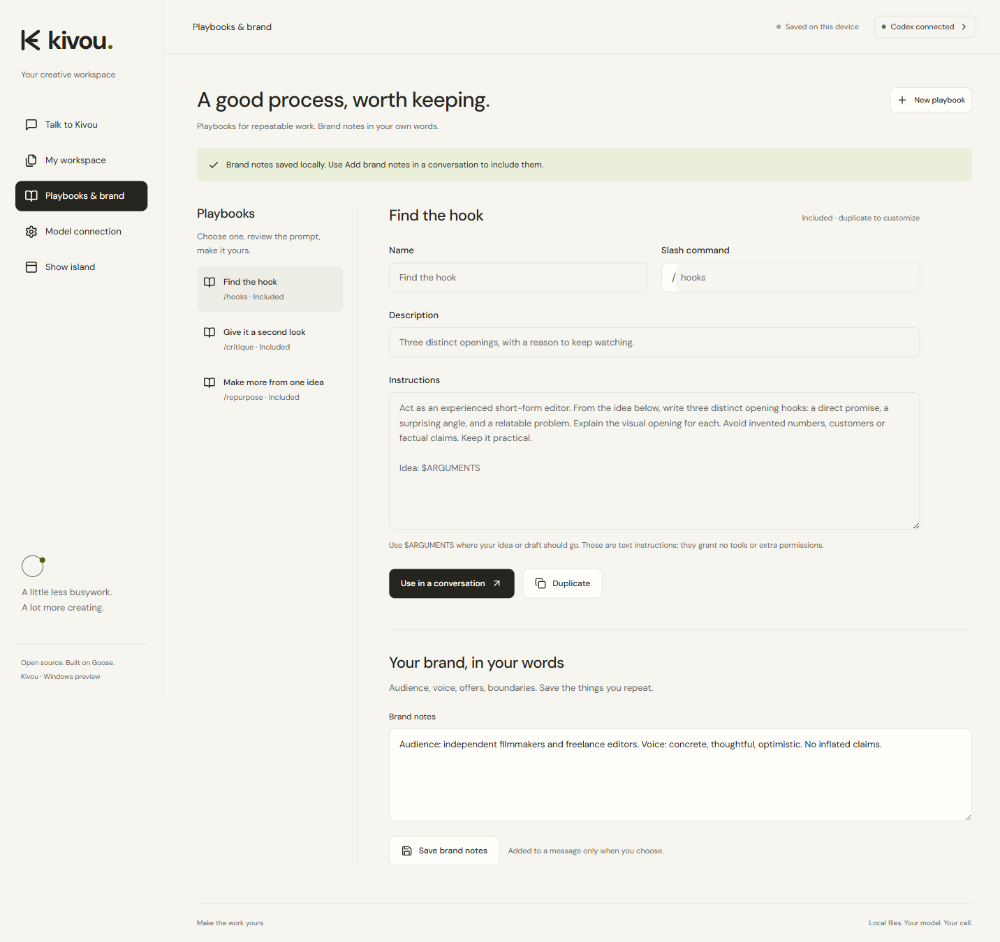

# Kivou

**Your AI companion. Right where you work.**

Kivou is a Windows-first assistant for independent creators: a compact island at the top of your screen, project conversations that keep their context, and practical workflows for research, content and assets.

Built by [rayaneDR](https://github.com/rayaneDR). An independent, Apache-2.0 distribution built on [Goose](https://github.com/aaif-goose/goose), with its source history and credits preserved.

[](docs/media/kivou-introduction.mp4)

[Watch the English introduction](docs/media/kivou-introduction.mp4) · [Windows guide](docs/kivou/WINDOWS.md) · [Verification](docs/kivou/VERIFICATION.md)

**0.3 preview status:** the actual Windows executable passed native island checks, project conversation checks and real model calls. The source is public; release assets are being prepared for [GitHub Releases](https://github.com/rayaneDR/kivou/releases). This is an unsigned Windows x64 portable preview.

## A little presence. A useful next step.

- **Desktop island:** expand a compact top-screen companion, ask a quick question, follow the actual run state, stop work or return to your workspace. `Ctrl + Alt + K` toggles it when the shortcut is available; the workspace and tray provide the same access.
- **Project conversations:** save a project brief, ask follow-up questions with the earlier context, reopen your work, and export an answer. Island notes survive a full restart and keep the last successful context after an interrupted or cancelled turn.
- **Playbooks:** reuse original included prompts or save your own. `/hooks`, `/critique` and `/repurpose` expand into editable instructions before anything is sent.
- **Brand notes:** save your audience and voice locally, then explicitly add them to a visible message when useful.
- **Saved-answer search:** find a project by its title, your message or a phrase in a previous answer. Local keyword matching works without a model.
- **Research Brief:** prepare a draft with source suggestions and explicit uncertainties. Source links remain unverified until you review them.
- **Content Pack:** turn supplied text into three hooks, a short script, shot list, captions and platform copy. A conversation answer can be handed straight into the workflow.
- **Asset Manifest:** inventory filenames and sizes and propose organization. Original files stay where they are.





## Get started on Windows

1. Download the portable ZIP from a published [release](https://github.com/rayaneDR/kivou/releases) and check its attached SHA-256 file.
2. Extract the whole folder and open `Kivou.exe`.
3. For AI conversations and drafting, install **Node.js 24+** and the **Codex CLI**, then sign in to Codex with your own eligible ChatGPT account. Check the connection in Kivou.
4. Ask from the island, start a project conversation, or choose a creator workflow.

Closing the workspace keeps Kivou available in the system tray. Use the tray's **Quit Kivou** command to exit. There is no auto-start installation.

Your model account's limits apply. There is no automatic paid API fallback. Asset Manifest works without a model. Kivou does not import credentials or connected plugins from the chat in which it was developed.

## Local work, explicit model access

Project briefs and conversation context are sent to the connected model only when you allow a message or workflow. Run records and Markdown/JSON exports stay local. The island does not read your screen, clipboard or unrelated files.

General conversation provides advice and drafts; it does not execute commands, operate other apps, publish or send messages. Live research is a separate workflow. Conversations are bounded to 20 turns and 80,000 characters of context; start a new project with a summary at the limit. [Data handling](docs/kivou/DATA-HANDLING.md).

## Development

Use Node.js 24+ and an installed Codex CLI signed in with ChatGPT. Prepare the pinned Windows runtime, then run the focused application:

```powershell
.\scripts\prepare-kivou-runtime.ps1
cd ui/creator
npm ci
npm run build
npm start
```

`npm run package:windows` creates the portable application directory. Packaging alone is not verification: see [the Windows guide](docs/kivou/WINDOWS.md) for smoke checks and real-model checks.

The runtime is pinned to Goose **v1.56.0**, commit `9949cf926cd42f1d128b9991ed23a496ecace896`. The inherited Rust source and original desktop remain in the repository; Kivou's entry point is `ui/creator`. [Original source instructions](README.upstream.md) · [Architecture](replica/architecture.md).

## What Kivou adds

| Inherited from Goose | Kivou implementation |
| --- | --- |
| Rust agent runtime and CLI | Native Windows island, tray and workspace lifecycle |
| ACP provider support | Saved project conversations and consented quick notes |
| Original general-purpose desktop source | Focused English creator workspace |
| Existing agent infrastructure | Three creator workflows, isolated records and separate exports |

The island interaction was informed by the public behavior of [Coucou](https://github.com/Louis-CFM/coucou). Kivou uses its own geometric K, interface code, colors and audio; no Coucou character, artwork, sounds or source were copied. This preview does not claim complete Goose or Coucou feature parity.

[Feature matrix](replica/features.csv) · [Change log](CHANGELOG-KIVOU.md) · [Test evidence](qa/checks.json) · [Editable Remotion video](promo/README.md) · [Feature research and decisions](docs/kivou/FEATURE-RESEARCH.md)

## Contributing and license

See the [Kivou contribution guide](docs/kivou/CONTRIBUTING.md). Useful contributions include reproducible Windows bug reports, accessible interaction improvements and tests for cancellation, context recovery or exports. Remove private paths, secrets and content from reports. Kivou's CI is manually triggered; no automatic publishing workflow is enabled.

[Apache License 2.0](LICENSE). Upstream history and copyright notices are preserved. Kivou is independent and is not endorsed by Goose maintainers or the Agentic AI Foundation.
