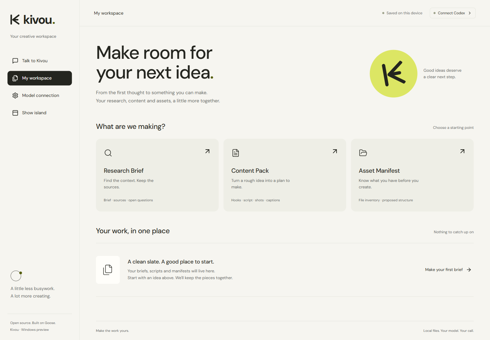
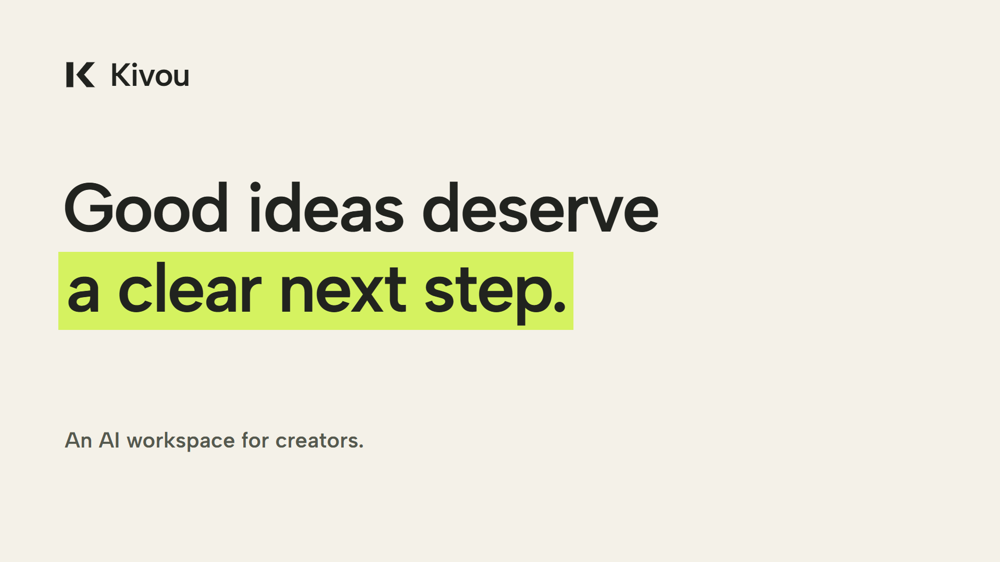

# Kivou

**From a rough idea to a reviewable content pack.**

Kivou is a Windows-first AI assistant for independent creators. Research a topic, shape a short script, and prepare a delivery folder with sources, drafts and a clear run history.

Built by [rayaneDR](https://github.com/rayaneDR) as a creator-focused fork of [goose](https://github.com/aaif-goose/goose). Kivou keeps the upstream source history and Rust runtime, and adds a focused Electron/React creator interface in `ui/creator`. The inherited general-purpose desktop source is preserved separately.

**Status:** Windows Electron smoke tests passed, including the packaged application. Real Content Pack and Research Brief calls completed through Goose/Codex ACP; research links remain unverified. The packaged runtime also completed a real Content Pack. The local Windows portable ZIP and source ZIP are ready with SHA-256 checksums. The public source is available in this repository. Windows release assets are being uploaded; a download is available only once the release is published. [Verification and limits](docs/kivou/VERIFICATION.md).



## Three ways to start

| Workflow | You provide | Kivou prepares |
| --- | --- | --- |
| Research Brief | A topic, audience and optional links | A draft brief, unverified source suggestions and explicit uncertainties |
| Content Pack | An idea or text transcript | Three hooks, a script, shot list, caption suggestions and platform copy |
| Asset Manifest | A folder you select | A metadata inventory and proposed file names; originals stay in place |

Each run gets its own folder. Markdown is easy to review; JSON keeps the structured result portable. Cancelled and interrupted runs retain their recorded state. Export creates a new delivery folder rather than replacing an earlier export.

## Bring your model access

The initial integration uses the installed Codex CLI through goose's `codex-acp` provider. Sign in through the normal Codex flow with your own eligible ChatGPT account. Your account's usage limits still apply; this is not unlimited or bundled inference. There is no automatic switch to a paid API provider.

Provider checks establish that executables and login are available. Only a successful real workflow establishes model compatibility. [goose ACP provider documentation](https://goose-docs.ai/docs/guides/acp-providers/) · [OpenAI authentication documentation](https://learn.chatgpt.com/docs/auth)

## Local files, reviewable results

- App data and exports are local. Prompts, supplied text and selected research links go to the configured model provider during AI runs.
- An Asset Manifest inventories names and metadata, without reading file contents or moving, renaming or deleting originals.
- Research links are model-reported evidence that needs human review. A citation is not independent verification of a claim.
- Content Pack does not generate video, transcribe audio, publish posts or send messages.
- The app does not import the credentials, connected plugins or permissions of the chat in which it was developed.

Read [data handling](docs/kivou/DATA-HANDLING.md) for storage, exports and execution boundaries.

## Get started on Windows

The public source repository is [rayaneDR/kivou](https://github.com/rayaneDR/kivou), on the `kivou` default branch. The Windows x64 portable ZIP has passed packaged smoke and real-model checks. Release assets are uploading; check [Releases](https://github.com/rayaneDR/kivou/releases) for published downloads.

For development, use Node.js 24+ and an installed Codex CLI signed in with ChatGPT. From the repository root, prepare the pinned Windows Goose v1.56.0 runtime, then build and start the focused creator app:

```powershell
.\scripts\prepare-kivou-runtime.ps1
cd ui/creator
npm ci
npm run build
npm start
```

The ACP adapter is a locked application dependency. [The Windows guide](docs/kivou/WINDOWS.md) covers the backend download, Electron setup, connection checks and packaging. `npm run package:windows` prepares the Windows app directory; its creation alone is not a launch test or public release.

[Windows guide](docs/kivou/WINDOWS.md) · [creator service integration](creator/README.md) · [architecture](replica/architecture.md)

This fork starts from goose **v1.56.0**, commit `9949cf926cd42f1d128b9991ed23a496ecace896`. The unchanged Rust backend is supplied by the official pinned Windows artifact; a local Rust build is not required for this distribution path. The original desktop/source instructions remain in [README.upstream.md](README.upstream.md) and [the upstream desktop guide](ui/desktop/README.md).

## What is ours, what is inherited

| Inherited from goose | Kivou additions |
| --- | --- |
| Rust agent and CLI | Three creator workflows |
| Preserved general-purpose desktop source | Focused Electron/React creator application |
| ACP provider and MCP infrastructure | Isolated run records and non-overwriting delivery exports |
| Existing session and provider capabilities | Metadata-only asset manifests and a focused Windows guide |

See the [feature matrix](replica/features.csv) for implementation status and the [change log](CHANGELOG-KIVOU.md) for the fork's changes. An inherited capability is not a new Kivou invention.

## Demo and contribution

The **24-second English introduction** was made in Remotion using actual application captures and original synthesized audio. It is 1080p at 30 fps, with verified playback. Research/Content shots are clearly labelled preview forms; Asset Manifest shows actual local inventory of synthetic sample files.

[](docs/media/kivou-introduction.mp4)

[Watch/download MP4](docs/media/kivou-introduction.mp4) · [Editable Remotion source](promo/README.md) · [Video verification](promo/QA.md)

Inherited GitHub automation is preserved in `.github/upstream-workflows`; Kivou's own CI is manually triggered. No automatic release or publishing job is enabled.

Useful contributions include a reproducible Windows bug report, an improvement to a creator workflow, and tests for export or cancellation behavior. Describe the expected and observed results, your application version and whether a real provider or test fixture was used. Remove private paths, tokens and content before attaching logs.

## License and credits

[Apache License 2.0](LICENSE). This repository retains goose's history and copyright notices. Kivou is an independent distribution and is not endorsed by the goose maintainers or the Agentic AI Foundation. The name and new presentation do not change ownership of upstream work.

The initial Kivou work is by rayaneDR. Upstream contributors and their notices remain credited in the source history and preserved files.
